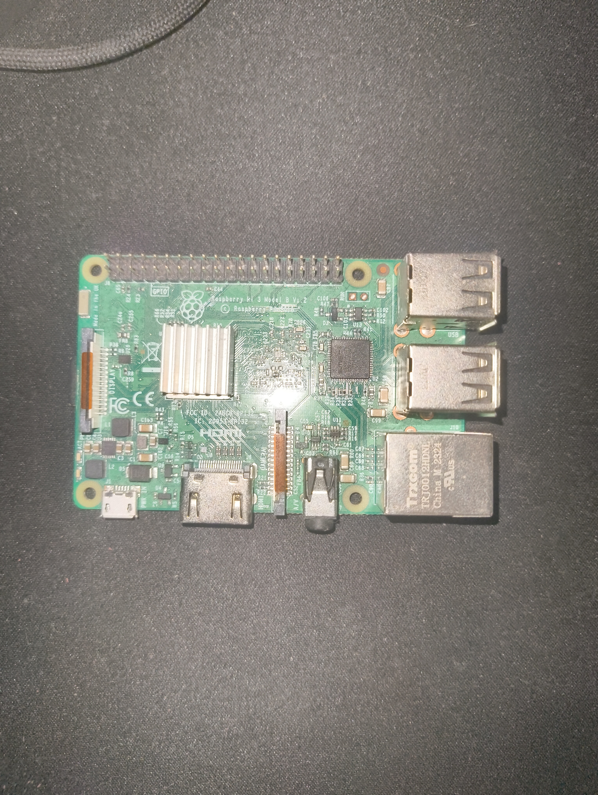

	<h1>Homelab</h1>
	<a href="./README.md">
🇬🇧 • English version
</a>

This repository is a dedicated to explain what compose my homelab and how i have do it. But before starting you will problably ask me, "What is a homelab". An homelab is like an infrastructure that we can find on the real world. It is often use to learn and experiment on real devices. Every services that run on your homelab is here because you decide to add and configure it. My homelab is a little "crappy" because ive take what i have at home without paying a single euros in additionnal hardware. My homelab is compose by two device:
1. A Rasberry Pi 3B+
	- A rasberry pi is a "cheap" little computer that doesnt consume that much energy and who have the size of a credit card.
	- It run Alpine instead of the default rasberry Pi Rasbian image because i dont have much ressources available so ive choose the alpine to get the lightest operation system that i can
	- To avoid as much as possible overheating probleme, I have put a heat-sink getted from an old TV decoder on the CPU to disperse the heat produce by it.

	

		
		
<it>Picture of my Rasberry Pi</it>

	

	
2. A MSI laptop
	- This computer is a MSI (ahhh forget the ref). It have an Intel I5, 8Gb of RAM in DDR3 and have a NVIDIA GTX 760m
	- The operating system that run on it is Proxmox VE (Virtual Environment). It's used to create virtual machines 

	<h1>Rasberry Pi</h1>

Ive install Alpine instead of a simple Rasbian because my rasberry pi only have 1Gb of RAM so i needed to have the lightest operating who is possible with the minimal requirement. Also, i found that Alpine is more stable than Rasbian on my Rasberry PI. Since ive switch to Alpine ive done less troubleshooting.

Each services who run on this devices is containerized using docker container.
Here the list of services that run:
- Pi-hole : A DNS server who can blocked DNS request to adventising server and act like a simple DNS server
- Jellyfin : A streaming server
- Forgejo : An host localy and opensource alternative to Github
- Nginx : A simple reverse proxy that i olso use as a static server for my portal
- Kuma : An uptime manager that send me a discord message through a webhook if one of those services are done

	<h1>MSI laptop</h1>

