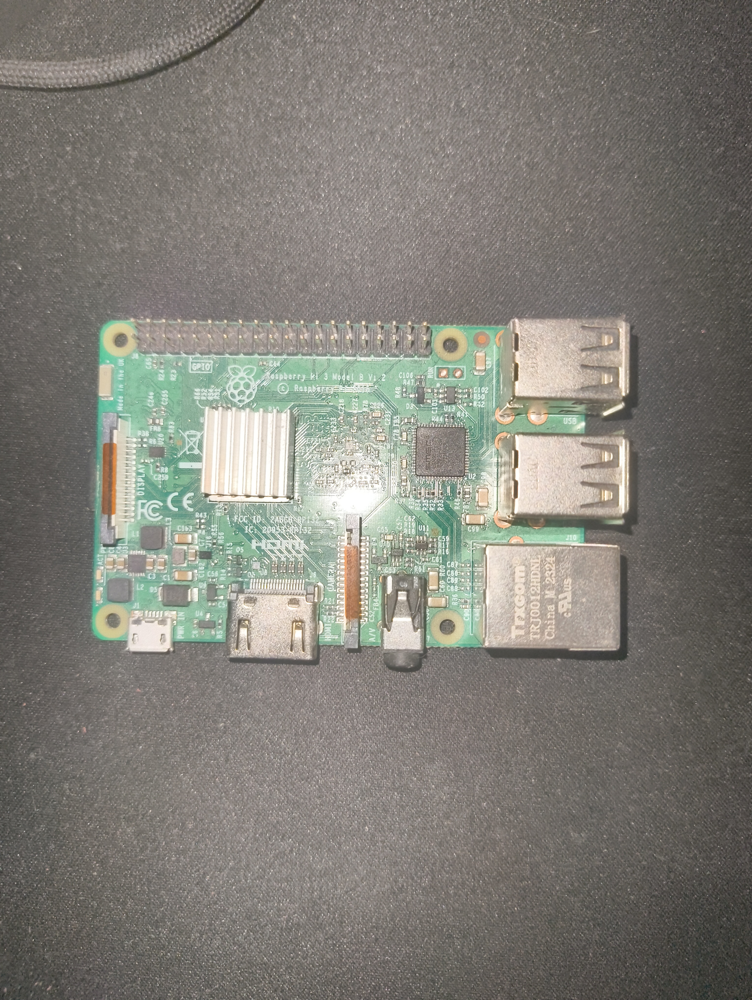
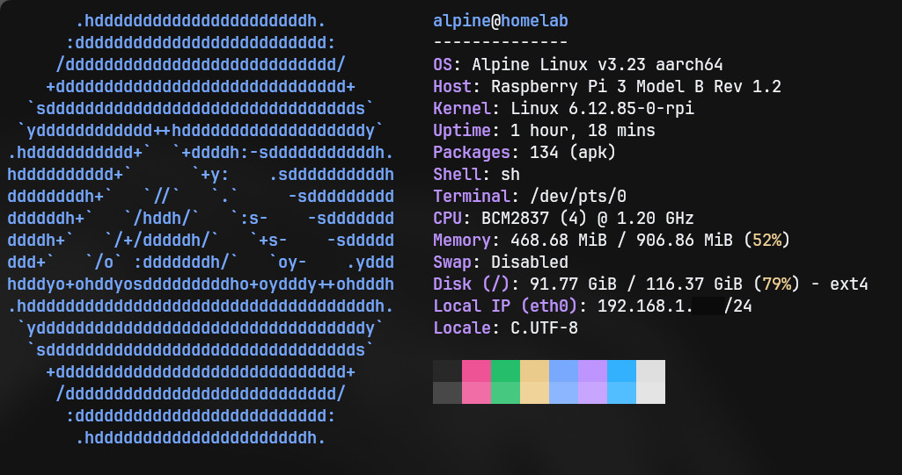

	<h1>Homelab</h1>
	<a href="./FR_README.md">
🇫🇷 • French version
</a>

This repository is a dedicated to explain what compose my homelab and how i have do it. But before starting you will problably ask me, "What is a homelab". An homelab is like an infrastructure that we can find on the real world. It is often use to learn and experiment on real devices. Every services that run on your homelab is here because you decide to add and configure it. My homelab is a little "crappy" because ive take what i have at home without paying a single euros in additionnal hardware. My homelab is compose by two device:

	<h1>Rasberry Pi</h1>

- A Raspberry Pi is a small, affordable computer about the size of a credit card. It uses little electricity and can run a full operating system, just like a regular computer. People use it to learn programming, build projects, and run simple servers or other embedded systems.
- My Raspberry Pi runs Alpine Linux instead of Raspberry Pi OS (formerly Raspbian). Since the Pi has limited resources, I chose Alpine because it’s lightweight and helps keep resource usage low.
- To avoid as much as possible overheating probleme, I have put a heat-sink getted from an old TV decoder on the CPU to disperse the heat produce by it. With this little upgrade my ive lose 20% degree on a full use with every core at 100 percent

 

	
	
<it>Picture of my Rasberry Pi</it>

	
	
<it>A fastfetch of my Rasberry Pi</it>

<h2>Services</h2>

- [Pi-hole](./docs/en/pi-hole.md) : A DNS server who can blocked DNS request to adventising server and act like a simple DNS server
- [Jellyfin](./docs/en/jellyfin.md) : A streaming server
- [Forgejo](./docs/en/forgejo.md) : An host localy and opensource alternative to Github
- [Nginx](./docs/en/nginx.md) : A simple reverse proxy that i olso use as a static server for my portal
- [Kuma](./docs/en/kuma.md) : An uptime manager that send me a discord message through a webhook if one of those services are done

	<h1>MSI laptop</h1>

- This computer is a MSI (ahhh forget the ref). It have an Intel I5, 8Gb of RAM in DDR3 and have a NVIDIA GTX 760m
- The operating system that run on it is Proxmox VE (Virtual Environment). It's used to create virtual machines
