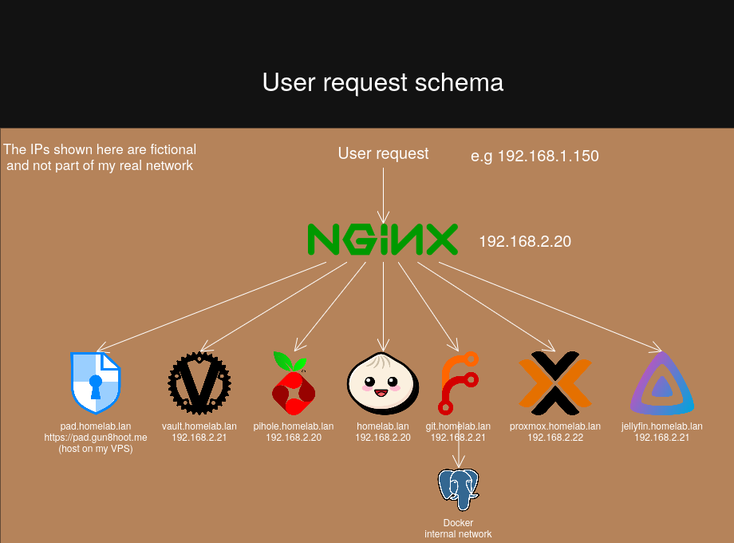
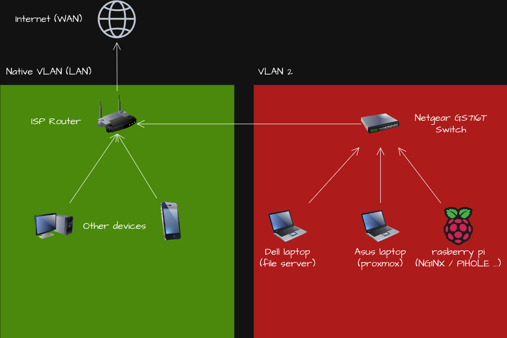
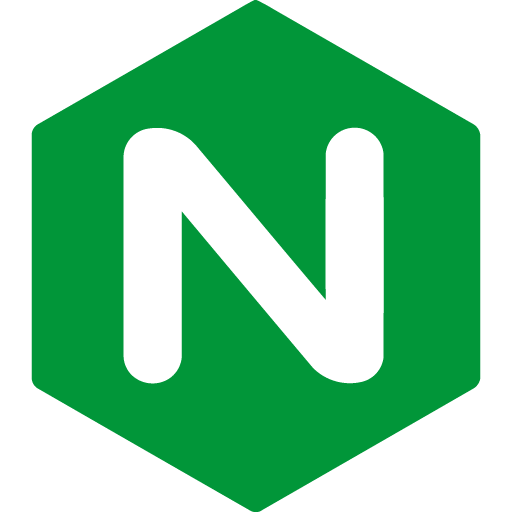

<div align="center">
	<h1>Homelab</h1>
</div>

<div align="center">
	<a href="./FR_README.md"><p>🇫 • French version</p></a>
	<a href="./docs"><p>Documentation</p></a>
</a>
</div>

> [!WARNING]
> Im still building the project, some part can be missing

<div align="center">
	<h2>Description</h2>
</div>

This repository documents what my homelab is made of and how I built it.

It is composed of:

- **Two laptops**, both running Debian. One of them also hosts a Proxmox VE instance.
- **A Raspberry Pi** running Alpine Linux, where most of the self-hosted services live.
- **A network switch**: An old unmanaged 10/100Mbps switch for now. I've bought a second-hand **Netgear GS716T** — a 16-port gigabit smart managed switch — for around 20€ to replace it, but it hasn't been delivered yet (see [Switch](./docs/en/hardware/SWITCH.md)).
- **Ethernet cabling**: For now, most of the cables are CAT 5E except for the first laptop which uses a CAT 6 cable.

<div align="center">
	<h2>What is a homelab?</h2>
</div>

A homelab is a small infrastructure, similar to what you would find in a professional environment, but built at home for services that are used every day or almost every day. It is often used to learn and experiment on real devices, and that is mainly why I built mine. Every service running on a homelab is there because you decided to install and configure it yourself.

This side project helps me learn a lot about:

- real-world networking, beyond simulators such as Cisco Packet Tracer and GNS3
- system administration across multiple devices
- infrastructure architecture
- virtualization, reverse proxying, DNS and VPN setups
- self-hosting and maintaining services over time

<div align="center">
	<h2>Architecture overview</h2>
</div>

Everything is containerized with Docker Compose. NGINX acts as the single entry point: it terminates TLS and routes each subdomain (e.g. `https://kuma.homelab.lan`) to the right container over an internal Docker network. Pi-hole resolves those `*.homelab.lan` names to the NGINX host.

<div align="center">
	
	<p><i>Schema representing a request done by a client</i></p>
	<br>
	
	<p><i>Schema of my network with VLAN</i></p>
	<br>
</div>

<div align="center">
	<h2>Quick start</h2>
</div>

1. Copy the environment template and fill in your values (passwords, volume locations, timezone, SSL certificate paths):

	```bash
	cp config/.env.template config/.env
	```

2. Generate a self-signed certificate for NGINX (or point `SSL_CERTIFICATE_LOCATION` / `SSL_KEY_LOCATION` at your own):

	```bash
	make cert
	```

3. Enable the services you want by uncommenting their `include:` line in `config/docker-compose.yaml`, then start everything:

	```bash
	make up      # build and start every enabled service in the background
	make logs    # follow the logs of every service
	make ps      # list running services
	make down    # stop everything
	make re      # down + up
	```

Point your devices' DNS at the Pi-hole host and you're done: every service becomes reachable at `https://<service>.homelab.lan`.

<div align="center">
	<h2>Documentations</h2>
</div>

<div align="center">
	<h3>Hardware used</h3>
</div>

- [Raspberry Pi](./docs/en/hardware/RASBERRY.md) (Alpine Linux)
- [Asus gaming laptop](./docs/en/hardware/ASUS_LAPTOP.md) (Debian)
- [Dell laptop](./docs/en/hardware/ASUS_LAPTOP.md) (Debian)
- [Netgear GS716T](./docs/en/hardware/SWITCH.md) (switch)

<div align="center">
	<h3>Services available</h3>
</div>

<table>
	<thead>
		<tr>
			<th width="20%">Logo</th>
			<th>Service</th>
			<th>Description</th>
		</tr>
	</thead>
	<tbody>
		<tr>
			<td align="center"></td>
			<td><a href="./docs/en/services/NGINX.md">NGINX</a></td>
			<td>The main reverse proxy. It routes incoming requests to every service on the backend, so each one is reachable through its own subdomain.</td>
		</tr>
		<tr>
			<td align="center"></td>
			<td><a href="./docs/en/services/KUMA.md">Uptime Kuma</a></td>
			<td>A self-hosted monitoring tool that checks whether my services and domains are up. If one of them goes down, it sends me a message through a Matrix bot.</td>
		</tr>
		<tr>
			<td align="center"></td>
			<td><a href="./docs/en/services/PIHOLE.md">Pi-hole</a></td>
			<td>A network-wide DNS sinkhole that blocks ads and trackers. It also lets me define local DNS records across my network.</td>
		</tr>
		<tr>
			<td align="center"></td>
			<td><a href="./docs/en/services/VAULTWARDEN.md">Vaultwarden</a></td>
			<td>A lightweight, open-source, unofficial implementation of the Bitwarden server API. It lets me self-host my password manager and use the official Bitwarden clients.</td>
		</tr>
		<tr>
			<td align="center"></td>
			<td><a href="./docs/en/services/LANDING_PAGE.md">Landing page</a></td>
			<td>A landing page displayed when accessing <code>https://homelab.lan</code> on my network. It lists links to every available subdomain.</td>
		</tr>
		<tr>
			<td align="center"></td>
			<td><a href="./docs/en/services/WIREGUARD.md">WireGuard</a></td>
			<td>A VPN server that lets me securely access all my services when I'm not at home.</td>
		</tr>
		<tr>
			<td align="center"></td>
			<td><a href="./docs/en/services/FORGEJO.md">Forgejo</a></td>
			<td>A self-hosted, open-source alternative to GitHub, backed by its own PostgreSQL database.</td>
		</tr>
		<tr>
			<td align="center"></td>
			<td><a href="./docs/en/services/OVERLEAF.md">Overleaf</a></td>
			<td>A self-hosted collaborative LaTeX editor.</td>
		</tr>
		<tr>
			<td></td>
			<td><a href="./docs/en/services/SAMBA.md">Samba</a></td>
			<td>An SMB file share accessible from every device on my network.</td>
		</tr>
		<tr>
			<td align="center"></td>
			<td><a href="./docs/en/services/ANKI_SYNC.md">Anki Sync Server</a></td>
			<td>A self-hosted implementation of the AnkiWeb sync API. It lets me sync my flashcard collections between my Anki clients without going through AnkiWeb.</td>
		</tr>
		<tr>
			<td align="center"></td>
			<td><a href="./docs/en/hardware/ASUS_LAPTOP.md">Proxmox</a></td>
			<td>The virtualization platform used to run virtual machines on this laptop, including a REMnux instance for malware analysis and a plain Debian guest for experiments.</td>
		</tr>
	</tbody>
</table>

<div align="center">
	<h2>What's next?</h2>
</div>

- Add more services
- Isolate my server part using an another VLAN to protect my backend from attack originating inside my own native VLAN.
- Buy better hardware such as a more powerful computer.
- Build/buy a server rack (around 10U should be great but more will be perfect)
- Replace CAT5-E cable with CAT 6 ethernet cable
