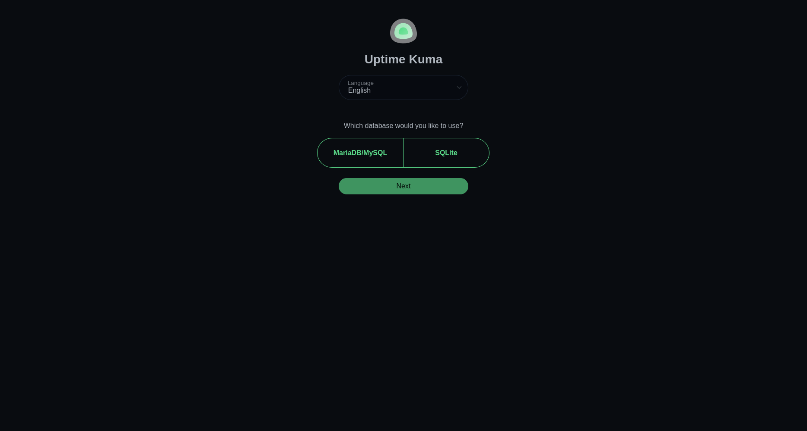
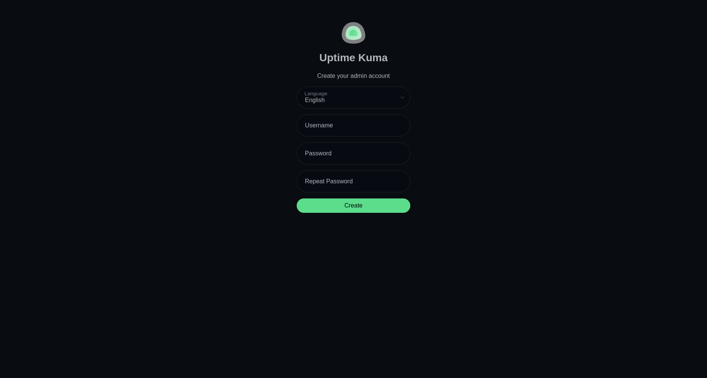
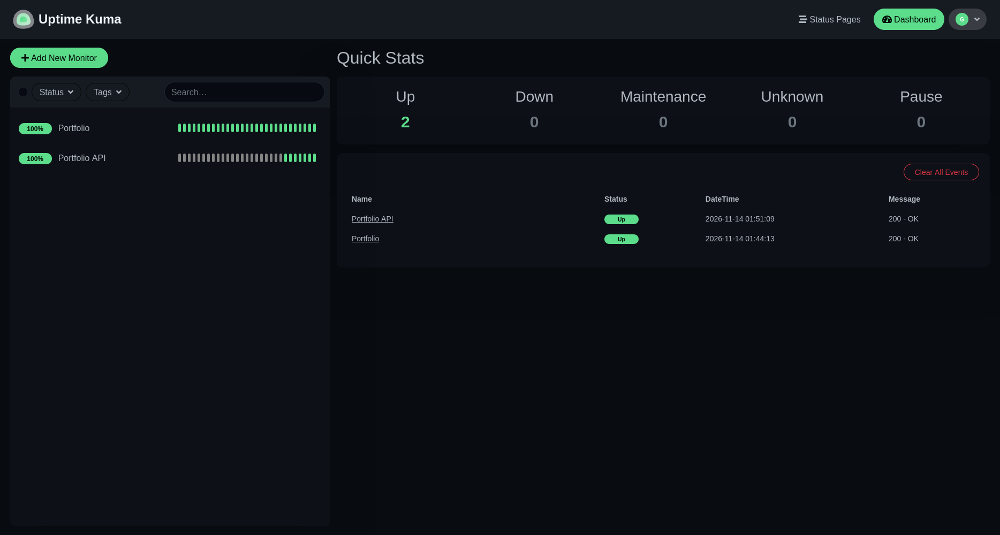

<div align="center">
	<h1>Kuma Uptime</h1>
</div>

Kuma Uptime is a self-hosted monitoring service that regularly sends requests to configured servers and websites to check whether they are available and responding as expected. It tracks uptime and response times, records incidents, and can send alerts when a monitored service goes down or comes back online.


<div align="center">
	<h2>Configuration</h2>
</div>

Since everything on my homelab run throught docker using a docker compose file. The installation is done with every other services on my rasberry pi. The docker compose configuration is pretty simple and come from the [**Kuma Uptime official github repository**](https://github.com/louislam/uptime-kuma)

```yaml
  kuma:
    container_name: homelab-kuma
    image: louislam/uptime-kuma:2.5.11-slim
    volumes:
      - ~/infra_data/kuma:/app/data
    restart: unless-stopped
```

`kuma:` : Is the name of the service<br>
`container_name: homelab-kuma` : Is the name of the container on the host<br>
`image: louislam/uptime-kuma:2.5.11-slim` : The link to the docker image on **Docker Hub**<br>
`volumes:` : This section define every volumes who will be use by our services. Here we will use the folder located at `~/infra_data/kuma` on the host and mount it into `/app/data` on our container<br>
`restart: unless-stopped` : This restart policy say that if our container crash or if the computer is shutdown, it will automaticly restart the container without any manual user intervention<br>

Once the container is launched, you can go to http://{PLACEHOLDER} and you will go to Kuma web panel. The first time, you will be redirect to http://{PLACEHOLDER}/setup-database. On this page you will choose between on of two (three on most recent version) relational database that kuma will use to store his data. You can choose : 
- PostgreSQL
	- Pros:
	- Cons:
- MariaDB
	- Pros:
	- Cons:
- SQLite
	- Pros:
	- Cons:

The easiest choise is to choose SQLite because Kuma do the entire configuration by itself and that the lightest database between those three<br>


<br>

After creating the database, kuma will ask you to create the admin user who will manage every monitor


<br>

The kuma panel look like this : 


<br>
