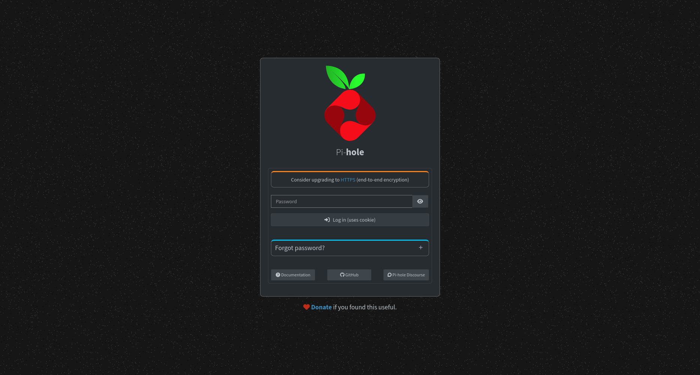
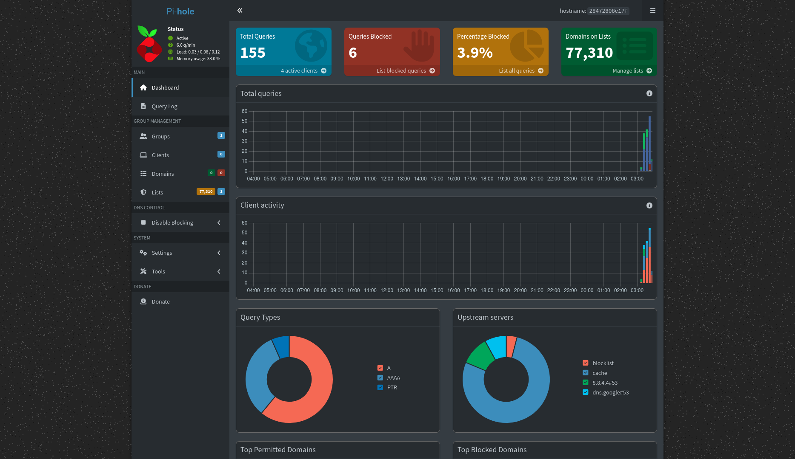
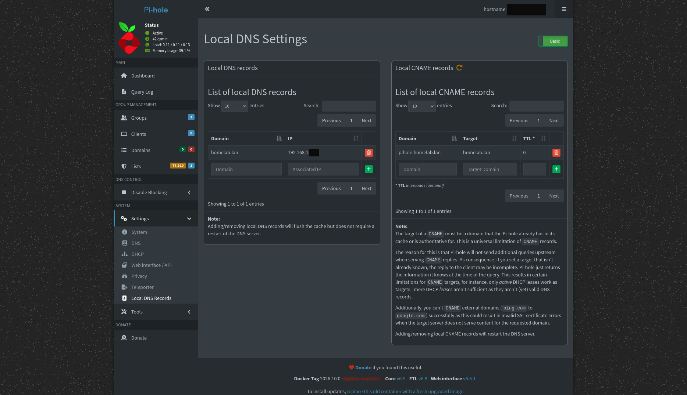

<div align="center">
	<h1>Pi-hole</h1>
</div>

Pi-hole is a self-hosted, network-wide DNS filtering service that blocks requests to known advertising and tracking domains. Devices using Pi-hole for DNS can benefit from filtering without needing separate ad-blocking software. It can also resolve custom local domain names to IP addresses, making it easier to access devices and services on your network.

My main goal by hosting this services on my homelab is to block tracking/advertising domain and assing my reverse proxy to a domain name like `http://homelab.lan` so i can connect easly from every devices on my network

<div align="center">
	<h2>Configuration</h2>
</div>

```yaml
  pihole:
    container_name: pihole
    image: pihole/pihole:2026.10.0
    ports:
      # DNS Ports
      - "53:53/tcp"
      - "53:53/udp"
      # HTTP Port
      - "8080:8080/tcp"
    environment:
      TZ: 'Europe/Paris'
      FTLCONF_webserver_api_password: ${PIHOLE_WEB_PASSWORD}
      FTLCONF_dns_listeningMode: 'ALL'
    volumes:
      - './etc-pihole:/etc/pihole'
      # Uncomment the below if you have custom dnsmasq config files that you want to persist. Not needed for most starting fresh with Pi-hole v6. If you're upgrading from v5 you and have used this directory before, you should keep it enabled for the first v6 container start to allow for a complete migration. It can be removed afterwards. Needs environment variable FTLCONF_misc_etc_dnsmasq_d: 'true'
      #- './etc-dnsmasq.d:/etc/dnsmasq.d'
    restart: unless-stopped

```

`pihole:` : The name of the service <br>
`container_name: pihole` : The name of the docker container <br>
`image: pihole/pihole:2026.10.0` : The image to use who will be pull from docker hub <br>
`ports:` : This section define which port are open. With my configuration 2 port are open <br>
- 53 (both TCP and UDP) : The port use by DNS request
- 8080 (TCP) : The port use by for the pannel
`environment:` : This section will define every environment variable who will be used on the container <br>
- `TZ: 'Europe/Paris'` : Your timezone, since im in France, i set it to `Europe/Paris`
- `FTLCONF_webserver_api_password: ${PIHOLE_WEB_PASSWORD}'` : The password of the admin account, it should be defined in the `.env` file on the srcs/ folder
- `FTLCONF_dns_listeningMode: 'ALL'` : 
`volumes:` : The volume section that define where the volume should be create on the host and mount on the container. Pi-hole use only one volume to store every configuration files.
`restart: unless-stopped` : This restart policy say that if our container crash or if the computer is shutdown, it will automaticly restart the container without any manual user intervention<br>

Once the pihole docker container is up, you can go to `http://homelab.lan/admin/login` and connect using the password defined in **`PIHOLE_WEB_PASSWORD`** on the `.env` file


<br>

When connected to the admin account, you will be redirect to a panel where you see many statistics


<br>

The first thing that you can do is to go in **System < Settings < Local DNS Record**. On this setting page, you can manually assign an IP address to a domain. This page have two section : 
- Local DNS records : On this section, you can assign an IP address to a domain. There are two field:
	- Domain : The domain name we want assign to the IP
	- IP : The IP address we want assign to the domain
- Local CNAME records : On this section, you will
	- Domain : The domain name we want assign to the IP
	- TARGET : The domain name we want assign to the IP
	- TTL : Is the time that the server will 


<br>

Next thing you can do is to go in
