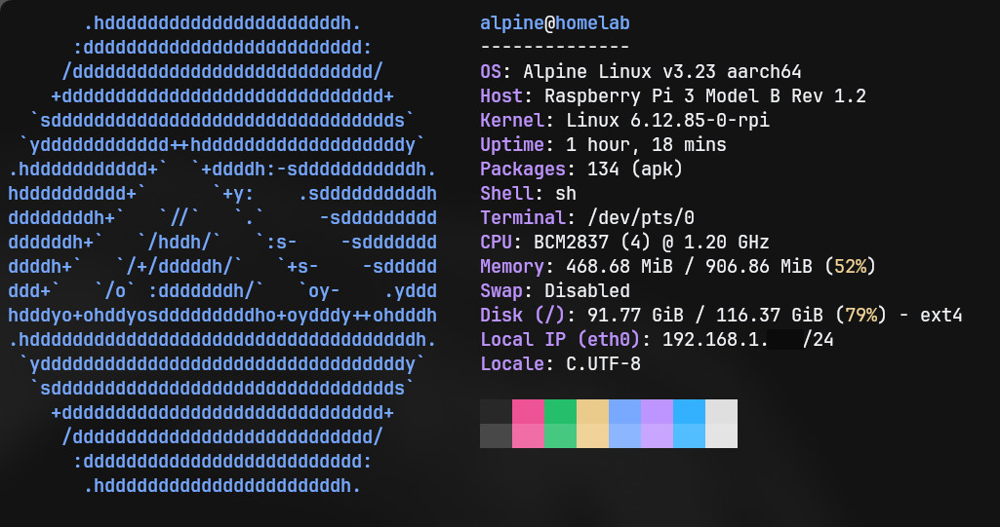
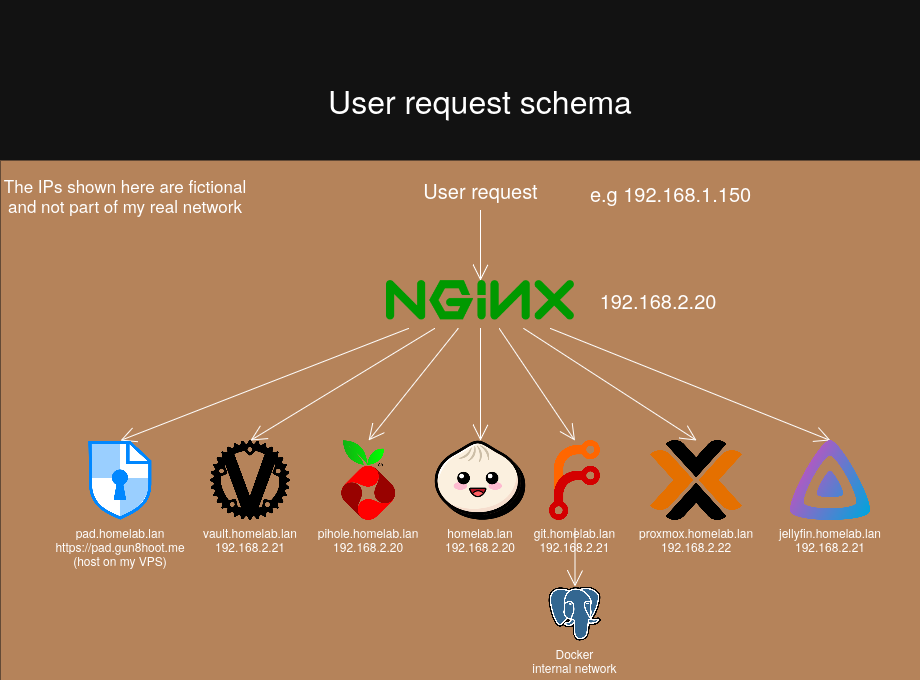

	<h1>Raspberry Pi</h1>

This device is a **Raspberry Pi 3B**: a small, affordable computer about the size of a credit card. It uses little electricity and can run a full operating system, just like a regular computer. It only has 1GB of RAM, so every resource counts.

The OS that runs on the device is **Alpine Linux**1, chosen over the default Raspberry Pi OS (Raspbian) because it's the lightest distribution available, which matters a lot with only 1GB of RAM. I've also found it more stable than Raspbian on this device — since the switch, I've done far less troubleshooting.

Every service running on this device is containerized with **Docker**2, using the compose files under [`config/`](../../../config/), driven by the root [`config/docker-compose.yaml`](../../../config/docker-compose.yaml) where I comment in the services I want.

To avoid overheating problems as much as possible, I salvaged a heat-sink from an old TV decoder and put it on the CPU to dissipate the heat it produces.

	
	
<i>Raspberry Pi 3B</i>

	
	
<i>Fastfetch output — the Raspberry Pi specs at a glance</i>

	<h2>Services running on it</h2>

1. [Pi-hole](../services/PIHOLE.md):
   One of the most important services of my infrastructure. Pi-hole acts as my network's DNS3 server: when a client tries to reach a URL like `https://proxmox.homelab.lan`, it first asks Pi-hole which IP address is associated with that domain. If the name is one of Pi-hole's local DNS records, Pi-hole answers directly with the IP of the NGINX host — the request never goes through a conventional public resolver like Cloudflare (1.1.1.1) or Google (8.8.8.8). If the domain isn't a local record, Pi-hole simply forwards the request to the configured upstream resolver. As a bonus, it also blocks DNS requests to known advertising and tracking domains for the whole network.

2. [NGINX](../services/NGINX.md):
   The second most important service of my infrastructure. NGINX is a **reverse proxy**4 — think of it as a receptionist: every request enters through the same door, and by reading the name asked for (e.g. `kuma.homelab.lan` vs `forgejo.homelab.lan`), NGINX forwards each request to the right service behind it. One entry point, many services, each with its own subdomain. It also handles the HTTPS certificates, so everything is encrypted without having to configure TLS on every single service.

   

3. [Uptime Kuma](../services/KUMA.md):
   A self-hosted uptime manager that regularly checks whether my services and domains are up by polling them every minute. If one of my subdomains or one of my homelab services goes down, it immediately sends me a message through the **Matrix**5 protocol, so I hear about the problem from a notification instead of finding out myself when something stops working. It also keeps an availability history for every monitor, visible at a glance on its dashboard at `https://kuma.homelab.lan`.

4. [Landing page](../services/LANDING_PAGE.md):
   A small custom web portal served at `https://homelab.lan`. It's a single-page app built with **TypeScript, React and Tailwind CSS**6, compiled at build time into static files that NGINX serves directly. It lists a link to every available service of the infrastructure in one place — instead of remembering each subdomain by heart, opening the homelab's root URL shows everything at once. It acts as the homepage of my homelab.

	<h2>Notes</h2>

- Alpine Linux uses `apk` and OpenRC instead of `apt` and systemd — worth knowing before SSH-ing into it.
- All persistent data lives under `${VOLUMES_LOCATION}` (see [`.env.template`](../../../config/.env.template)), so a container can be destroyed and recreated without losing anything.
- With 1GB of RAM, keep an eye on `docker stats`: every enabled service counts, which is why the master compose file lets you comment services in and out.

	<h2>Glossary</h2>

1. **Alpine Linux**: A security-oriented, lightweight Linux distribution. It uses musl and BusyBox instead of the heavier glibc/systemd combination most distributions rely on, giving it a tiny RAM and disk footprint — ideal for a device with only 1GB of RAM.
2. **Docker (containerization)**: A way of running each service in its own isolated "container": a lightweight, self-contained package holding everything the service needs to run. Services stay separated from each other, and a container can be destroyed and recreated from its compose file without losing data, as long as the data lives in mounted volumes.
3. **DNS (Domain Name System)**: The internet's phonebook: it translates human-readable domain names (e.g. `proxmox.homelab.lan`) into the IP addresses machines actually use to talk to each other. Every connection starts with a DNS query.
4. **Reverse proxy**: A server that sits in front of other servers and receives every incoming request. By looking at the requested name, it decides which backend service the request belongs to and forwards it there. The backends stay hidden from the network — only the proxy is exposed.
5. **Matrix**: An open, decentralized messaging protocol (the one behind the Element app). I receive Uptime Kuma's alerts through a bot that posts in a room, so a notification pops up on my phone like any other chat message.
6. **TypeScript / React / Tailwind CSS**: The stack the landing page is built with: TypeScript is JavaScript with static typing, React is a framework for building user interfaces from reusable components, and Tailwind CSS is a utility-first styling library. A build step (run by the [Bun](https://bun.sh) runtime) compiles the whole app into plain HTML/CSS/JS files that NGINX serves directly — no code runs on the server to display the page.
