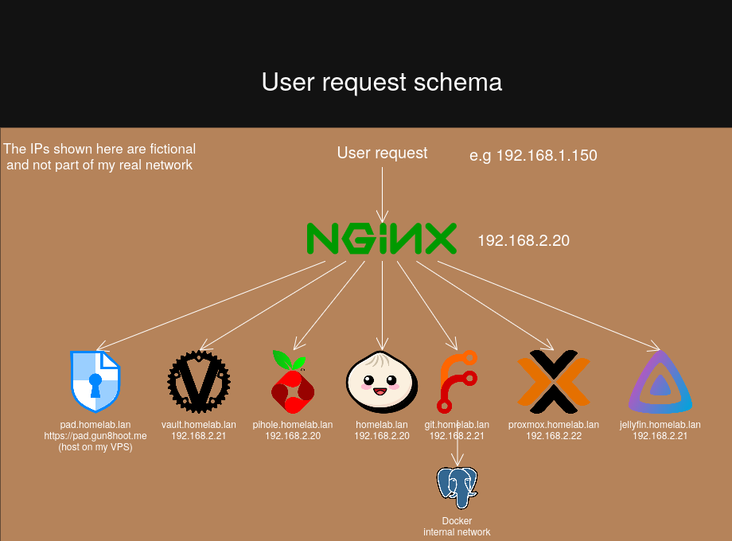

	<h1>Network</h1>

This page documents how my network is organized as a whole: the physical wiring between the devices, the path a client request follows to reach a service, and how the internal Docker networks keep everything isolated. For the details of each device or service, see the [hardware](../hardware/SWITCH.md) and [services](../services/NGINX.md) documentations.

	<h2>Physical topology</h2>

- **The switch** is the central point of the network: an old unmanaged 10/100Mbps model for now, soon to be replaced by a [Netgear GS716T](../hardware/SWITCH.md) — a 16-port gigabit smart managed switch bought second-hand (pending delivery).
- **Wired to it**: the [Raspberry Pi](../hardware/RASBERRY.md) hosting most services, the [Asus laptop](../hardware/ASUS_LAPTOP.md) running Proxmox, the Dell laptop, and my daily devices.
- **Cabling**: mostly CAT5E — which handles gigabit fine up to 100 meters — except for the first laptop, which uses a CAT6 cable.
- **Addressing**: private LAN addresses, with every `*.homelab.lan` name resolved locally by Pi-hole (see [logical flow](#logical-flow) below).

**[SCHEMA PLACEHOLDER]** — Full topology diagram (devices, cables, ports, VLANs)

	<h2>Logical flow</h2>

Everything converges on the Raspberry Pi: Pi-hole answers every DNS1 query, and NGINX is the only container publishing ports on the network. A request for `https://kuma.homelab.lan` follows this path:

1. **DNS resolution** — the client asks Pi-hole for `kuma.homelab.lan`. A local DNS record2 answers directly with the IP of the NGINX host; the query never leaves my network.
2. **TLS termination3** — the client connects to NGINX, which decrypts the HTTPS traffic with the wildcard certificate for `*.homelab.lan`.
3. **Reverse proxying** — NGINX reads the requested name, and routes the request over an internal Docker network4 to the `kuma` container, which is the only one able to see that traffic.

From outside my home, the same entry point is reached through [WireGuard](../services/WIREGUARD.md).

	<h2>Docker networks</h2>

| Network | Role |
| --- | --- |
| `network_access` | Shared bridge between the services that need to reach each other (e.g. Uptime Kuma probing the other containers, the landing page testing service endpoints). |
| `nginx_network` | Connects NGINX to every backend — declared `internal: true`, so nothing outside NGINX can touch the backends, and no backend publishes a port. |
| `forgejo-isolated` | A network dedicated to Forgejo and its PostgreSQL database, so the reverse proxy (or any other service) can't reach the database directly. |

Only the NGINX container publishes host ports: 80/443 are the entry points for every subdomain, 22 is published but waits on the `stream` forwarding (see the [NGINX](../services/NGINX.md) TODO), and the DNS port is commented out for now — Pi-hole is reached directly on the LAN.

	<h2>Planned improvements</h2>

- **VLAN5 isolation**: cut the network into several isolated VLANs so an attack originating from a regular device can't reach the server part of the network. This is what motivated the purchase of a managed switch.
- **Cabling**: progressively replace the CAT5E runs with CAT6.
- **Rack**: build or buy a small server rack (~10U) to tidy the hardware up.

	<h2>Glossary</h2>

1. **DNS (Domain Name System)**: The system that translates human-readable names (e.g. `kuma.homelab.lan`) into the IP addresses machines actually use to talk to each other. Every connection starts with a DNS query.
2. **Local DNS record**: A manual entry in Pi-hole that answers a name-to-IP query directly, without forwarding it to an upstream public resolver. It's what makes `*.homelab.lan` names resolvable only inside my network.
3. **TLS termination**: The reverse proxy decrypts the incoming HTTPS traffic itself, using the certificate. The connection from NGINX to the backend containers then travels unencrypted over the internal Docker network — fine, since that network never leaves the host.
4. **Internal Docker network**: A virtual bridge network created by Docker: containers on it reach each other by container name without any published port. With `internal: true`, Docker also blocks all access from outside, so a backend is only reachable from the containers sharing that network.
5. **VLAN (IEEE 802.1Q)**: Lets one physical network behave like several fully separated ones: devices in different VLANs can't talk to each other unless a router allows it. It requires managed switches, since unmanaged ones can't tag frames.
