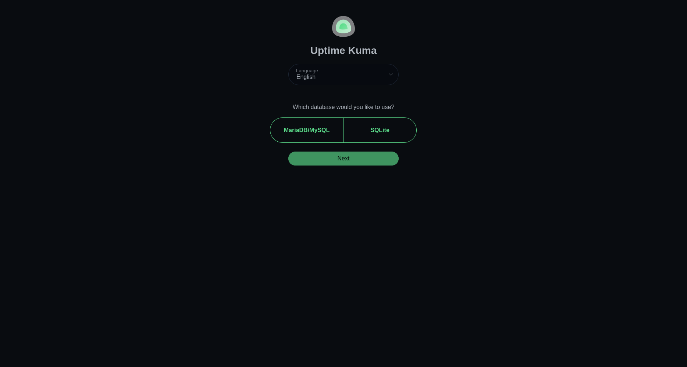
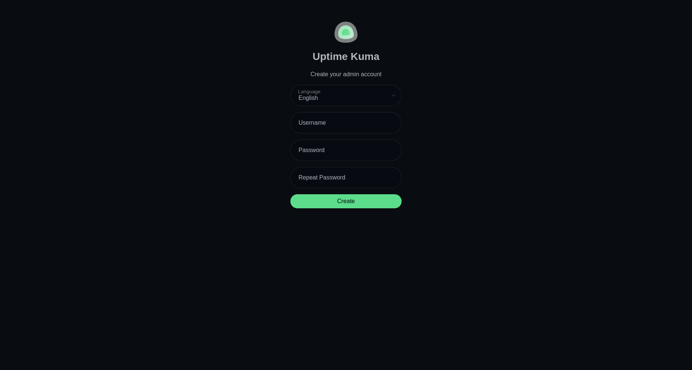
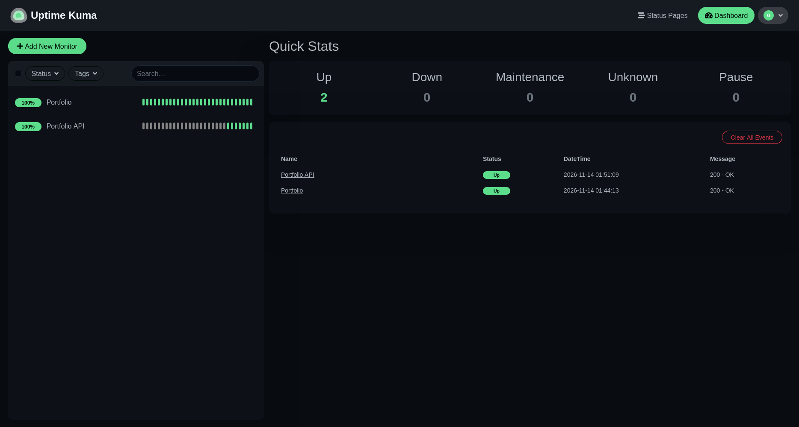
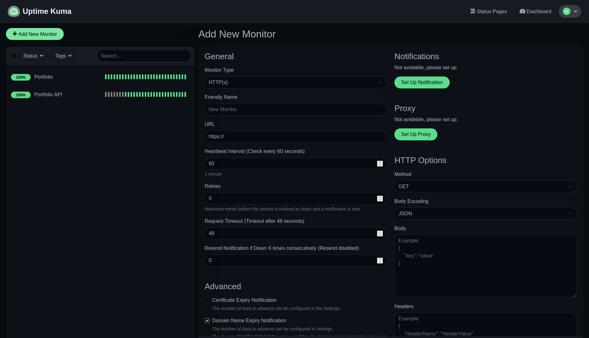

<div align="center">
	<h1>Kuma Uptime</h1>
</div>

Kuma Uptime is a self-hosted monitoring service that regularly sends requests to configured servers and websites to check whether they are available and responding as expected. It tracks uptime and response times, records incidents, and can send alerts when a monitored service goes down or comes back online.

<div align="center">
	<h2>Configuration</h2>
</div>

Since everything on my homelab runs through Docker using a docker compose file, the installation is done with every other service on my Raspberry Pi. The docker compose configuration is pretty simple and comes from the [**Kuma Uptime official github repository**](https://github.com/louislam/uptime-kuma)

```yaml
  kuma:
    container_name: homelab-kuma
    image: louislam/uptime-kuma:2.5.11-slim
    volumes:
      - ${VOLUMES_LOCATION}/kuma:/app/data
    restart: unless-stopped
    networks:
      - network_access
      - nginx_network
```

`kuma:` : Is the name of the service<br>
`container_name: homelab-kuma` : Is the name of the container on the host<br>
`image: louislam/uptime-kuma:2.5.11-slim` : The link to the docker image on **Docker Hub** (pinned to a specific version, and using the `-slim` variant to save space on the Pi)<br>
`volumes:` : This section defines every volume that will be used by our service. Here we use the folder located at `${VOLUMES_LOCATION}/kuma` on the host and mount it into `/app/data` on our container, so monitors, history and settings survive a container recreation<br>
`restart: unless-stopped` : This restart policy says that if our container crashes or if the computer is shut down, it will automatically restart the container without any manual user intervention<br>
`networks:` : Kuma sits on `nginx_network` so the NGINX reverse proxy can reach it, and on `network_access` so it can probe every other service by DNS name<br>

Once the container is launched, you can go to `https://kuma.homelab.lan` and you will land on the Kuma web panel. The first time, you will be redirected to `https://kuma.homelab.lan/setup-database`. On this page you will choose between one of the relational databases that Kuma will use to store its data. You can choose:
- PostgreSQL
	- Pros: the most robust option for large histories and multiple concurrent accesses
	- Cons: requires running and maintaining an extra database container, overkill for a small setup
- MariaDB
	- Pros: solid performance, familiar if you already run a MySQL/MariaDB stack
	- Cons: same extra-container overhead as PostgreSQL
- SQLite
	- Pros: zero configuration, Kuma handles everything by itself, and it's the lightest of the three — perfect for a Raspberry Pi
	- Cons: a single file database, less suited to heavy concurrent writes (not an issue at my scale)

The easiest choice is SQLite because Kuma does the entire configuration by itself and it is the lightest database between those three.


<br>

After creating the database, Kuma will ask you to create the admin user who will manage every monitor.


<br>

The Kuma panel looks like this:


<br>

<div align="center">
	<h2>Creating a monitor</h2>
</div>

To watch one of my services, I add a new monitor from the "Add New Monitor" page. My monitors are simple HTTP(S) checks pointed at each subdomain (e.g. `https://vault.homelab.lan`), with an interval of 60 seconds.


<br>

<div align="center">
	<h2>Alerting</h2>
</div>

When a monitor goes down, Kuma sends me a message through a **Matrix** notification. Matrix is chosen over a simple webhook because it's end-to-end encrypted, self-hostable, and I already run my own server — so the alerting chain stays fully under my control. The notification is configured in **Settings < Notifications** by filling in the Matrix homeserver URL, the access token of a dedicated bot account, and the target room ID.

This way, if NGINX, Pi-hole or any subdomain becomes unreachable, I get a message on my phone within a minute.
