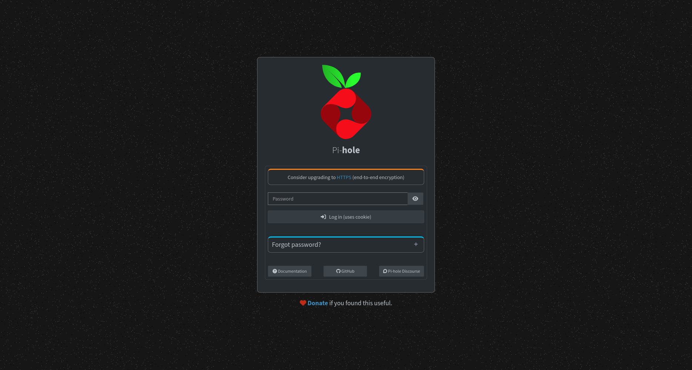
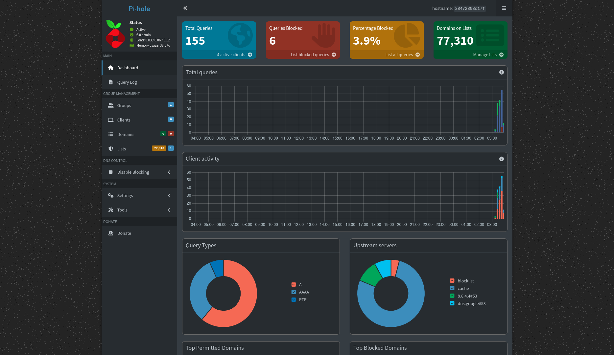
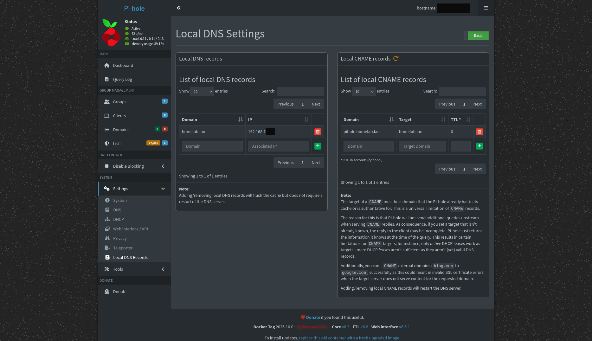

<div align="center">
	<h1>Pi-hole</h1>
</div>

Pi-hole is a self-hosted, network-wide DNS filtering service that blocks requests to known advertising and tracking domains. Devices using Pi-hole for DNS can benefit from filtering without needing separate ad-blocking software. It can also resolve custom local domain names to IP addresses, making it easier to access devices and services on your network.

My main goal by hosting this service on my homelab is to block tracking/advertising domains and assign my reverse proxy to a domain name like `https://homelab.lan` so I can connect easily from every device on my network.

<div align="center">
	<h2>Configuration</h2>
</div>

```yaml
  pihole:
    container_name: homelab-pihole
    image: pihole/pihole:2026.10.0
    environment:
      TZ: '${TIMEZONE}'
      FTLCONF_webserver_api_password: ${PIHOLE_WEB_PASSWORD}
      FTLCONF_dns_listeningMode: 'ALL'
      FTLCONF_webserver_port: '8080s'
    volumes:
      - ${VOLUMES_LOCATION}/pi-hole:/etc/pihole
    restart: unless-stopped
    networks:
      - nginx_network
```

`pihole:` : The name of the service<br>
`container_name: homelab-pihole` : The name of the docker container<br>
`image: pihole/pihole:2026.10.0` : The image to use, pulled from Docker Hub (version pinned for reproducible deployments)<br>
`environment:` : This section defines every environment variable used inside the container<br>
- `TZ: '${TIMEZONE}'` : Your timezone, read from the `.env` file. Since I'm in France, I set it to `Europe/Paris`
- `FTLCONF_webserver_api_password: ${PIHOLE_WEB_PASSWORD}` : The password of the admin account, defined in the `.env` file (see [`config/.env.template`](../../../config/.env.template))
- `FTLCONF_dns_listeningMode: 'ALL'` : Makes FTL answer DNS queries coming from any interface, not only localhost — required when Pi-hole serves the whole network from inside a container
- `FTLCONF_webserver_port: '8080s'` : Serves the web admin on port 8080 with TLS enabled (the `s` suffix), since all my traffic goes through HTTPS<br>
`volumes:` : The volume section that defines where the volume is created on the host and mounted in the container. Pi-hole uses only one volume (`${VOLUMES_LOCATION}/pi-hole`) to store every configuration file, so settings survive container recreation<br>
`networks:` : Pi-hole sits on `nginx_network`, so the NGINX reverse proxy can forward both its web panel (as `pihole.homelab.lan`) and DNS traffic (via the `stream` block) to it without publishing any port on the host<br>
`restart: unless-stopped` : This restart policy says that if our container crashes or if the computer is shut down, it will automatically restart the container without any manual user intervention<br>

Once the Pi-hole docker container is up, you can go to `https://pihole.homelab.lan/admin/login` and connect using the password defined in **`PIHOLE_WEB_PASSWORD`** in the `.env` file.


<br>

When connected to the admin account, you will be redirected to a panel where you can see many statistics: queries over time, top blocked domains, and the percentage of traffic that was filtered.


<br>

The first thing you can do is to go in **System < Settings < Local DNS Records**. On this settings page, you can manually assign an IP address to a domain. This page has two sections:
- **Local DNS records** : Here you assign an IP address to a domain. There are two fields:
	- Domain : The domain name we want to assign to the IP
	- IP : The IP address we want to assign to the domain
- **Local CNAME records** : Here you create an alias pointing to another name, useful when several services share one target. There are three fields:
	- Domain : The alias domain name that clients will query
	- Target : The existing domain name the alias points to
	- TTL : The time (in seconds) that the answer stays cached in a client's resolver before it asks the server again


<br>

The next thing you can do is to go in **Adlists** (under **Domains < Adlists**). This page manages the blocklists that Pi-hole pulls: each entry is a URL hosting a list of advertising/tracking domains. I keep the default lists and add a few community-maintained ones. Whenever you add or remove a list, you need to run **Tools < Update Gravity** so the new domains are actually loaded into the filtering database.

Finally, to make all of this effective for the whole network, point every device's DNS server (or your DHCP server's DNS setting) at the Pi-hole host. Devices that can't be reconfigured can be forced in **Group Management < Clients**, where you can also assign per-client groups if you ever need different filtering rules per device.
